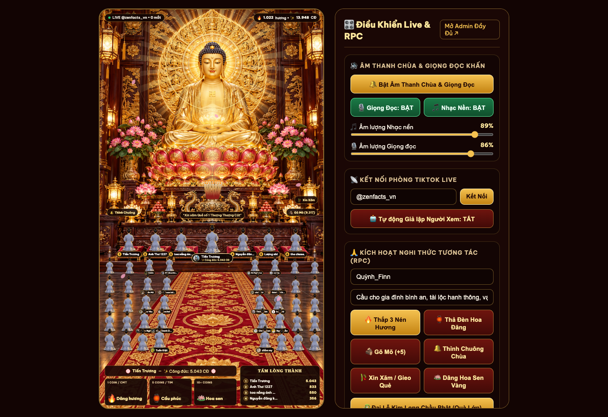
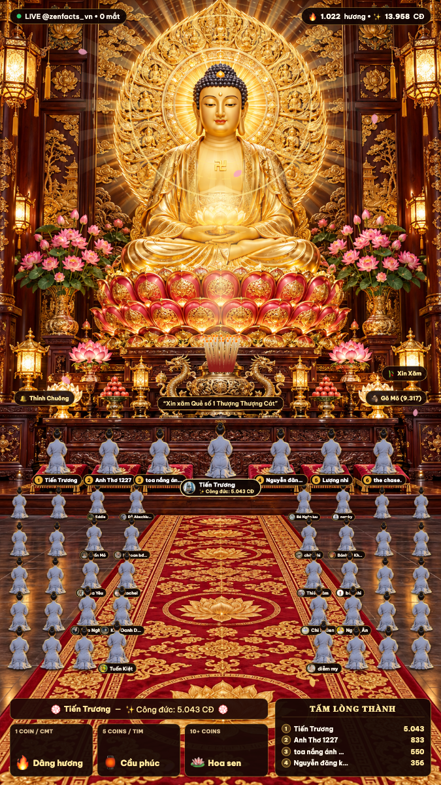
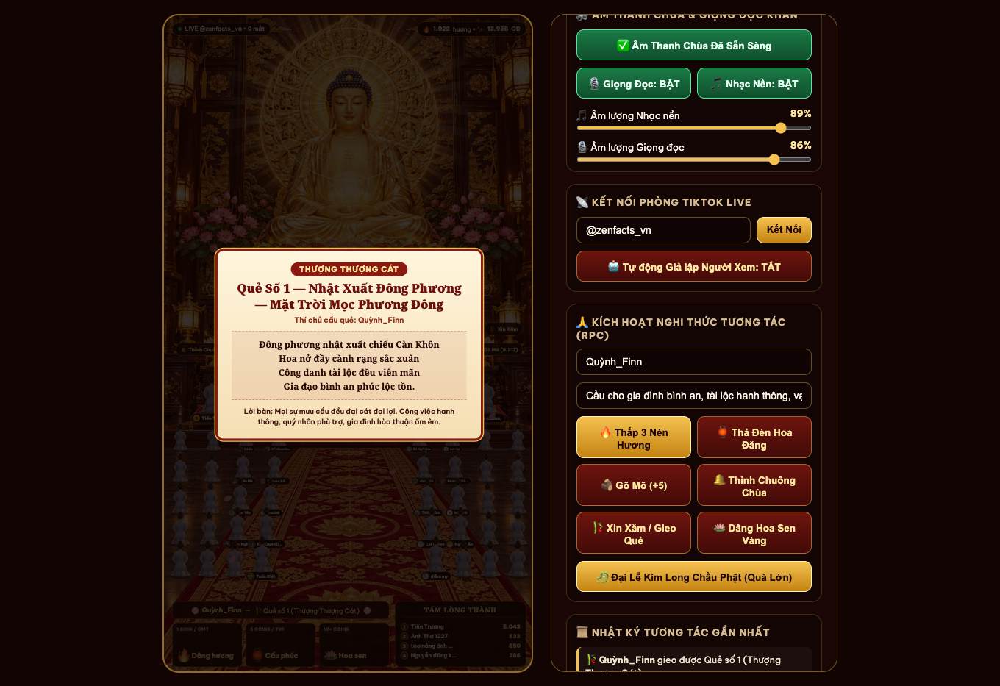
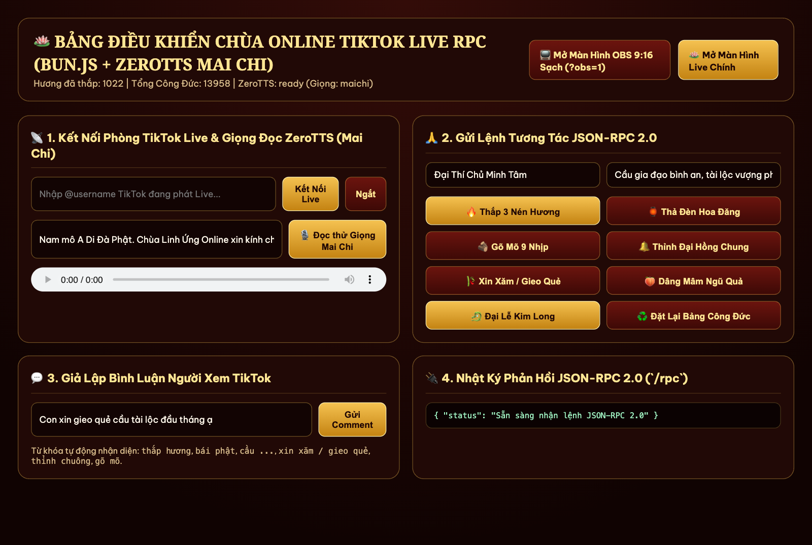

# 🪷 Chùa Linh Ứng Online — TikTok Live RPC (9:16 Interactive Buddhist Sanctuary)

Hệ thống phát trực tiếp tương tác (**Interactive TikTok Live Stream & JSON-RPC 2.0**) chuẩn khung dọc **9:16 (`1080×1920`)** dành cho **OBS Studio / TikTok Live Studio**, chạy siêu nhẹ trên **Bun.js** và tích hợp giọng đọc AI tiếng Việt **ZeroTTS (`zeroweight-ai/ZeroTTS`)**.

Người xem trên TikTok Live tương tác trực tiếp qua **Bình luận (Comment)**, **Thả tim (Like)**, **Chia sẻ / Follow** và **Tặng quà (Gift)** để thực hiện các nghi thức tâm linh trên màn hình Chánh Điện **Đức Phật A Di Đà**:
- 🔥 **Thắp hương & Đảnh lễ Tam Bái (8-Frame Walking & Prostration)**: Nhân vật Phật tử mặc áo lam bước đi từng bước dọc thảm đỏ hoa sen lên trước Lư Hương Đỉnh Đồng, hạ gối quỳ và thực hiện 3 lạy Ngũ thể đầu địa hướng về Đức Phật A Di Đà.
- 🏮 **Thả Đèn Hoa Đăng / Sớ Cầu Nguyện**: Bình luận lời khấn sẽ bay lên thành Đèn Hoa Đăng kèm giọng đọc AI đọc lời cầu nguyện.
- 🎋 **Xin Xăm / Gieo Quẻ Đầu Năm (Đồng bộ Giọng đọc & Tờ Giải Quẻ)**: Tự động lắc ống xăm và mở tờ Giải Quẻ (Thượng Thượng Cát, Đại Cát, Thượng Cát...) đúng thời điểm giọng đọc bắt đầu vang lên.
- 🪵 **Gõ Mõ & 🔔 Thỉnh Đại Hồng Chung**: Thả tim gõ mõ tích điểm Công Đức, chia sẻ/follow thỉnh chuông đồng lan tỏa sóng âm vàng và kích hoạt làn sóng vái lạy của 40+ Phật tử trong Đạo Tràng.
- 📜 **Bảng Vàng Công Đức (`TẤM LÒNG THÀNH` & 6 Đệm Quỳ VIP)**: Vinh danh trực tiếp người xem thật có điểm Công Đức cao nhất trên 6 đệm quỳ gấm đỏ trước bàn thờ Phật.

---

## 📸 Hình Ảnh Demo Giao Diện

### 1. Màn hình Chánh Điện 9:16 & Bảng Điều Khiển Nhanh (`http://localhost:3000`)


### 2. Chế độ OBS Browser Source 9:16 Sạch (`http://localhost:3000/?obs=1`) & Gieo Quẻ Linh Xăm
| Màn hình OBS 9:16 (`?obs=1`) | Tờ Giải Quẻ Linh Xăm (Đồng bộ Giọng Đọc) |
| :---: | :---: |
|  |  |

### 3. Bảng Điều Khiển JSON-RPC 2.0 & Admin (`http://localhost:3000/admin`)


---

## ⚡ Kiến Trúc & Tối Ưu Hóa Hiệu Suất (Siêu Nhẹ CPU/GPU)

- **Runtime**: Chạy trực tiếp trên **Bun.js** (`~0.1% CPU` khi chờ).
- **Canvas Particle Engine (`public/js/particles.js`)**:
  - Khóa tốc độ vẽ ở **30 FPS** ổn định, tự động tạm dừng khi ẩn tab (`document.hidden`).
  - Pre-render toàn bộ Khói hương, Hạt vàng và Cánh hoa sen ra Offscreen Canvas 1 lần duy nhất lúc khởi tạo (`drawImage`), không gọi `createRadialGradient` hay `shadowBlur` trong vòng lặp frame.
- **Zero-Flicker 8-Frame Sprite Stack (`public/js/live.js` & `public/css/live.css`)**:
  - Nạp sẵn cả 8 khung hình chuyển động (`walk1`, `walk2`, `kneelDown`, `kneel`, `forehead`, `bowMid`, `prostrate`, `prostrateDeep`) vào GPU với bóng đổ (drop-shadow) đã bake sẵn trong PNG, loại bỏ hoàn toàn hiện tượng nháy/mất hình khi chuyển tư thế.
- **ZeroTTS Worker (`tts_worker.py`)**:
  - Tiến trình Python thường trú nạp sẵn model `zeroweight-ai/ZeroTTS` (`intra_op_num_threads=3`, `OMP_WAIT_POLICY=PASSIVE` → **`0.0% CPU` khi chờ**).
  - Tổng hợp nguyên câu trong 1 lần gọi (`single-pass synthesis`), khử DC offset, chuẩn hóa đỉnh âm lượng (`peak <= 0.90`) và làm mượt 2 đầu sóng âm (`cosine fade-in/out`) chống xước/rè tiếng.
- **Bộ Lọc Chặn Ký Tự Lạ & Spam (`server.js` & `tts_worker.py`)**:
  - Chặn tự động các ký tự Cuneiform (`𒐫`), chữ Ả Rập gây lag, Braille, Zalgo, bình luận chỉ toàn dấu chấm (`...`) hoặc từ ngữ phản cảm.
  - Tự động chuẩn hóa Unicode (`NFKC` → `NFC`) chuyển tên kiểu chữ toán học về tiếng Việt sạch trước khi đọc TTS.

---

## 🚀 Hướng Dẫn Cài Đặt & Chạy Nhanh

### 1. Yêu cầu hệ thống
- [Bun.js](https://bun.sh/) (`>= 1.1`)
- Python `3.10+` & [`uv`](https://github.com/astral-sh/uv) (để tạo môi trường `.venv` chạy `zerotts`)

### 2. Cài đặt thư viện
```bash
# Cài đặt dependencies cho Bun / Node
bun install

# Tạo môi trường Python .venv và cài đặt ZeroTTS
uv venv .venv
uv pip install --python .venv/bin/python zerotts pillow
```

### 3. Khởi chạy Server
```bash
bun start
# Hoặc chế độ tự động reload khi sửa code:
bun run dev
```

Mặc định server chạy tại cổng `3000`:
- **Màn hình Live + Điều khiển nhanh**: [http://localhost:3000](http://localhost:3000)
- **Màn hình OBS Browser Source (Sạch 9:16)**: [http://localhost:3000/?obs=1](http://localhost:3000/?obs=1) *(Đặt kích thước Browser Source trong OBS là `1080 × 1920`)*
- **Bảng điều khiển Admin & RPC**: [http://localhost:3000/admin](http://localhost:3000/admin)

---

## 🎮 Bảng Quy Tắc Tương Tác TikTok Live

| Sự kiện TikTok Live | Điều kiện / Từ khóa | Nghi thức trên Chánh Điện | Điểm Công Đức |
| :--- | :--- | :--- | :---: |
| **Thả tim (Like)** | Mỗi đợt thả tim | Gõ mõ gỗ tụng kinh + Làn sóng Phật tử vái lạy | `+1` / tim |
| **Follow / Share** | Theo dõi hoặc chia sẻ | Thỉnh Đại Hồng Chung ngân vang + Sóng âm vàng | `+10` |
| **Bình luận Thắp hương** | `thắp hương`, `dâng hương`, `bái phật`, `lạy phật` | Phật tử bước dọc thảm đỏ lên trước Lư Hương, quỳ đảnh lễ 3 lạy + Đọc tên khấn | `+15` |
| **Bình luận Cầu nguyện** | `cầu ...`, `nguyện ...`, `nam mô`, `a di đà phật`, `bình an`, `chúc ...` | Bước lên đảnh lễ + Thả Đèn Hoa Đăng mang lời khấn bay lên trời + Đọc lời cầu nguyện | `+10` |
| **Bình luận Xin xăm** | `xin xăm`, `gieo quẻ`, `rút quẻ`, `quẻ` | Lắc ống xăm + Mở tờ Giải Quẻ đồng bộ đúng lúc giọng đọc bắt đầu vang lên | `+10` |
| **Tặng quà Nhỏ (1–4 xu)** | Hoa hồng (Rose), Heart Me... | Bước lên dâng Đài Hoa Sen Vàng + Thắp 3 nén hương + Đọc lời cảm tạ | `+20` / xu |
| **Tặng quà Vừa (5–99 xu)** | Đèn lưu ly, Mâm ngũ quả... | Dâng Đèn Lưu Ly / Mâm Ngũ Quả + Thỉnh Chuông + Đọc lời chúc phúc | `+30` / xu |
| **Tặng quà Lớn (≥ 100 xu)** | Quà ≥ 100 xu | **Đại Lễ Kim Long Chầu Phật**: Mưa hoa sen vàng, Hào quang vạn trượng, Chuông đồng ngân vang | `+50` / xu |

---

## 🔌 Giao Thức JSON-RPC 2.0 (`POST /rpc` & `ws://localhost:3000/ws`)

Bạn có thể gọi trực tiếp từ **TikFinity**, **Streamer.bot**, webhook hoặc `curl`:

```bash
# 1. Thắp hương cầu an
curl -X POST http://localhost:3000/rpc \
  -H "Content-Type: application/json" \
  -d '{
    "jsonrpc": "2.0",
    "id": 1,
    "method": "temple.burnIncense",
    "params": {
      "user": "Thí Chủ Minh Tâm",
      "count": 3,
      "wish": "Cầu gia đình bình an, vạn sự cát tường như ý"
    }
  }'

# 2. Xin xăm / Gieo quẻ đầu năm
curl -X POST http://localhost:3000/rpc \
  -H "Content-Type: application/json" \
  -d '{
    "jsonrpc": "2.0",
    "id": 2,
    "method": "temple.drawFortune",
    "params": {
      "user": "Thí Chủ Minh Tâm",
      "topic": "Cầu tài lộc và gia đạo bình an"
    }
  }'

# 3. Kết nối tới phòng TikTok Live (@username hoặc link vt.tiktok.com)
curl -X POST http://localhost:3000/rpc \
  -H "Content-Type: application/json" \
  -d '{
    "jsonrpc": "2.0",
    "id": 3,
    "method": "live.connect",
    "params": {
      "username": "@zenfacts_vn"
    }
  }'
```

### Danh sách JSON-RPC Methods hỗ trợ:
- `temple.getState`: Lấy toàn bộ trạng thái Chánh Điện và Bảng Vàng Công Đức.
- `temple.burnIncense`: Thắp nhang & bước lên đảnh lễ (`user`, `avatar`, `count`, `wish`).
- `temple.sendPrayer`: Thả đèn hoa đăng cầu nguyện (`user`, `avatar`, `wish`).
- `temple.drawFortune`: Lắc ống xăm & gieo quẻ (`user`, `avatar`, `topic`).
- `temple.strikeWoodenFish`: Gõ mõ tích công đức (`user`, `count`).
- `temple.ringBell`: Thỉnh Đại Hồng Chung (`user`, `count`, `wish`).
- `temple.offerGift`: Dâng lễ vật (`user`, `giftType`: `lotus` | `fruit` | `lamp` | `dragon`, `coins`, `giftName`).
- `temple.grandCeremony`: Kích hoạt Đại Lễ Kim Long Chầu Phật (`user`, `coins`, `giftName`).
- `temple.updateSettings`: Cập nhật âm lượng nhạc nền (`musicVolume`), giọng đọc (`ttsVolume`), bật/tắt TTS.
- `temple.resetMerit`: Đặt lại bảng thống kê Công Đức.
- `live.connect` / `live.disconnect`: Kết nối / Ngắt kết nối phòng TikTok Live.

---

## 📁 Cấu Trúc Thư Mục

```text
├── server.js                  # Bun.js HTTP + WebSocket JSON-RPC 2.0 Server & TikTok Live Connector
├── tts_worker.py              # Tiến trình Python ZeroTTS thường trú (48kHz, chống rè/clipping, lọc ký tự lạ)
├── data/
│   ├── merit-state.json       # Lưu trữ bền vững Bảng Vàng Công Đức của người xem thật
│   └── tts-cache/             # Bộ đệm file âm thanh WAV đã tổng hợp
├── public/
│   ├── index.html             # Giao diện Chánh Điện 9:16 + Bảng điều khiển nhanh
│   ├── admin.html             # Trang quản trị JSON-RPC 2.0 đầy đủ
│   ├── css/live.css           # Stylesheet tối ưu GPU Compositor
│   ├── js/
│   │   ├── live.js            # Điều phối 8-frame prostration, Đạo Tràng 40 chỗ ngồi & WebSocket RPC
│   │   ├── particles.js       # 30 FPS Offscreen-Sprite Particle Engine (Khói hương, Hoa sen, Sóng âm)
│   │   └── audio.js           # Quản lý nhạc nền auto-ducking, Pháp khí Web Audio & hàng đợi đồng bộ TTS
│   └── assets/                # Hình nền Đức Phật A Di Đà, 8 frame Phật tử áo lam & nhạc nền
└── docs/
    ├── demo/                  # Hình ảnh chụp màn hình demo thực tế
    └── superpowers/specs/     # Tài liệu thiết kế kỹ thuật (Design Spec)
```
